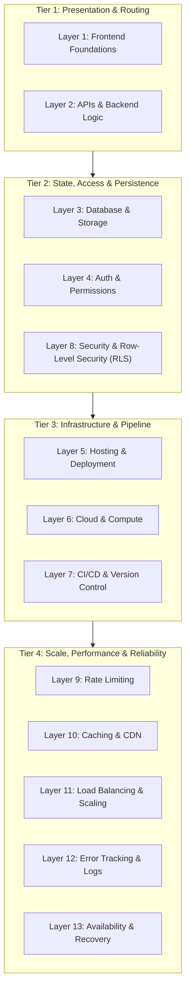

# Matt Murphy (`@mattmurphyai`) & The Faction: Complete Engineering Playbook & Video Knowledge Base

> **Creator**: Matt Murphy ([@mattmurphyai](https://www.instagram.com/mattmurphyai/) / [mattmurphy.ai](https://mattmurphy.ai))  
> **Organization**: The Faction Group LLC ([gofactiongroup.com](https://gofactiongroup.com))  
> **Community**: The Faction ([the-faction.mn.co](https://the-faction.mn.co/))  
> **Topic**: AI-Directed Engineering (AIDE), Vibe Coding with Production Discipline, The 13-Layer Audit, and The Operator Journey.

---

## Executive Summary: The Core Philosophy

Matt Murphy's core message across all his reels, shorts, and guides addresses the **fatal flaw of "Vibe Coding"**:

> *"Anyone can vibe code a prototype with Claude or Cursor in 30 minutes. But AI models naturally build for a single user with zero infrastructure. If you don't enforce production discipline, your app will collapse under real traffic, expose user data, or break when edge cases hit."*

His solution is **AI-Directed Engineering (AIDE)**:
* You don't need to be a 10-year syntax developer.
* You **do** need to act as an Engineering Director directing AI agents with strict architectural boundaries, explicit instruction files ("Skills"), and structured audits.

---

## Part 1: The 13-Layer Production Standard

Across all his videos, the centerpiece of his engineering audit and curriculum is the **13-Layer Architecture Check**. Every app must pass these 13 layers before going live:

### The 13 Layers Detailed:

| Layer # | Domain | What AI Gets Wrong (The Trap) | The Production Standard (The Fix) |
|:---:|---|---|---|
| **1** | **Frontend Foundations** | Builds bloated, messy components with purple glow gradients, hardcoded colors, and chaotic state. | Strict design system (8px grid, WCAG AA contrast), modular component tree, and typed client state. |
| **2** | **APIs & Backend Logic** | Unvalidated API routes accepting raw JSON strings; endpoint errors crash the server. | Strict schema validation with Zod/Pydantic; typed request/response contracts; consistent error envelopes. |
| **3** | **Database & Storage** | Raw string SQL, missing indexes on foreign keys, naive `timestamp` instead of `timestamptz`. | Strictly typed ORM/schema, online migrations (`CREATE INDEX CONCURRENTLY`), automated backups, zero table locks. |
| **4** | **Auth & Permissions** | Weak client-side checks (hiding buttons with `if (!user)` instead of enforcing server gates). | Server-side cryptographic token verification, session expiration, and explicit Role-Based Access Control (RBAC). |
| **5** | **Hosting & Deployment** | Hardcoded secrets in client bundles; manual server deployments. | Immutable container/edge builds; environment secrets stored in managed secret managers (Infisical/AWS SSM). |
| **6** | **Cloud & Compute** | Stateful lambdas causing cold start memory leaks and runaway cloud bills. | Stateless compute containers, timeout boundaries, memory capping, and autoscaling triggers. |
| **7** | **CI/CD & Version Control** | Pushing directly to `main`; zero automated tests; unreviewed commits. | Automated GitHub Actions pipelines, pre-commit lint/test hooks, and mandatory pull request reviews. |
| **8** | **Security & RLS** | Multi-tenant apps leaking one customer's data to another due to missing query filters. | Multi-tenant composite keys `(tenant_id, id)` enforced by Postgres Row-Level Security (RLS); automated SAST scans. |
| **9** | **Rate Limiting** | Open endpoints vulnerable to credential stuffing, API scraping, or LLM token draining. | Token-bucket rate limiting (Upstash Redis) on all auth, public, and expensive LLM proxy endpoints. |
| **10** | **Caching & CDN** | Every page hit hammers the primary database directly with redundant heavy queries. | Stale-while-revalidate edge caching, CDN asset distribution, and Redis query caching for read-heavy routes. |
| **11** | **Load Balancing & Scaling** | Database connection exhaustion during concurrent traffic spikes. | Connection pooling (PgBouncer/Prisma Accelerate), horizontal container scaling, and graceful degradation. |
| **12** | **Error Tracking & Logs** | Using `console.log("error")`; developers discover bugs only when angry users complain. | Structured JSON telemetry, automated Sentry/PostHog crash reporting, and real-time team alerts. |
| **13** | **Availability & Recovery** | Zero disaster recovery plan; catastrophic data loss if a server or volume is corrupted. | Automated Point-in-Time Recovery (PITR), multi-region redundancy, health checks, and a proven restore runbook. |

---

## Part 2: The 7 Standing Daily Workflow Plays

In Module 04 of the DIY Vibecoding Kit and in his short-form videos on agent execution, Matt Murphy outlines the **7 Daily Plays** to run with AI coding assistants (Claude Code, Cursor, Codex):

1. **Play 1: The Spec Write (Never Code First)**
   * *Rule*: Forbid the AI from generating code until a written specification (`docs/SPECS/<feature>.md`) is drafted and approved.
   * *Contents*: Problem statement, acceptance criteria, schema changes, and edge-case table.
2. **Play 2: Implement Feature (Surgical Diffs)**
   * *Rule*: Keep diffs strictly focused on the approved spec. Refuse "drive-by" refactors of unrelated files.
3. **Play 3: Debug Loop (Test-First Reproductions)**
   * *Rule*: When an issue occurs, write a failing unit or integration test reproducing the bug before touching the codebase.
4. **Play 4: Security Audit**
   * *Rule*: Run automated security scans before staging. Check for leaked API keys, unsanitized parameters, and missing auth guards.
5. **Play 5: Test Write**
   * *Rule*: Write unit, boundary, and edge-case tests matching framework conventions (Jest, Vitest, Pytest).
6. **Play 6: Review & Deploy**
   * *Rule*: Perform a cold diff review reading beyond the hunks; check external callers; run automated verify pipelines.
7. **Play 7: Stuck Loop Escape (Context Reset)**
   * *Rule*: When the AI agent enters a hallucination loop or repeats the same error twice, immediately wipe session context or switch models rather than arguing with it.

---

## Part 3: "Audit In, Audit Out" (The Conveyor Belt)

Matt Murphy uses the **Conveyor Belt** methodology in The Faction:

1. **Audit In**:
   * When receiving an existing repo or starting a new feature, run a rapid 13-layer audit.
   * Score each layer as **Pass**, **Warning**, or **Critical**.
   * Prioritize the critical infrastructure gaps (usually RLS, Secrets, and Error Handling) before adding flashy features.
2. **Build Phase**:
   * Execute using the 7 Standing Plays in isolated git worktrees.
3. **Audit Out**:
   * Re-run the 13-layer audit. Ensure zero regressions were introduced and that all new endpoints are secured, cached, and logged.

---

## Part 4: The Operator Journey (For Founders & Business Owners)

For non-technical operators and founders wanting to integrate AI into real-world business operations, Matt outlines a **7-Step Transformation Path**:

1. **Read the Playbook**: Study *Not Murphy's Law* to adopt the builder mindset and avoid common enterprise AI traps.
2. **The 30-Day AI Prescription**: Audit everyday team workflows to find repetitive, high-friction, low-leverage tasks (data entry, quote drafting, status reporting).
3. **AI Readiness Self-Assessment**: Score data conditions, risk boundaries, and team readiness before spending on enterprise software.
4. **Build an AI Chief of Staff (The Bertha Kit)**: Create an operational assistant managing daily agendas, email triage, meeting notes, and decision cadences.
5. **Run an Internal Team Hackathon**: Engage staff directly to identify the top 3 internal software tools that would save hours each week.
6. **Prototype Custom Software (DIY Vibecoding)**: Build internal MVPs with AI tools using the 13-layer discipline rather than buying bloated SaaS subscriptions.
7. **Join The Faction Community**: Participate in peer audits, earn skill tokens, and complete engineering certifications.

---

## Part 5: Key Quotes & Actionable Takeaways

* **On Vibe Coding**:
  > *"Vibe coding is the ignition switch, not the steering wheel. If you don't know what a composite foreign key or a rate limiter is, the AI will happily let you launch an app that leaks every user record on Day 1."*
* **On AI Agents**:
  > *"Treating an AI agent like a magic chatbot always fails. Treating an AI agent like an apprentice who must follow written skill files, verify their own work, and pass automated tests always succeeds."*
* **On Sovereign AI**:
  > *"Own your data, own your infrastructure, own your models. Never build your core business logic as a brittle wrapper around an opaque third-party cloud API."*

---

*Document compiled from Matt Murphy (`@mattmurphyai`) educational content, The Faction curriculum, and public engineering playbooks.*
